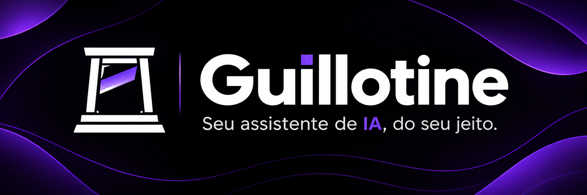

# Guillotine 🇫🇷

<p align="center">
  <a href="https://github.com/guilherme-o-lindo/guillotine-ai">
    
  </a>
</p>

<p align="center">
  <a href="LICENSE"></a>
  
  
  
  
</p>

<p align="center">
  <a href="#-sobre-o-projeto">Sobre</a> |
  <a href="#-diferenciais">Diferenciais</a> |
  <a href="#-funcionalidades">Funcionalidades</a> |
  <a href="#-arquitetura">Arquitetura</a> |
  <a href="#-tecnologias">Tecnologias</a> |
  <a href="#-instalação">Instalação</a> |
  <a href="#-roadmap">Roadmap</a> |
  <a href="#-contribuições">Contribuições</a>
</p>

<p align="center">
  Um assistente pessoal de inteligência artificial modular, extensível e independente de provedores.
</p>

## 🌐 Idiomas

<p align="center">
  
  
</p>

## ⚡ Quick-start

O Guillotine busca reunir modelos, memória e ferramentas de inteligência artificial em um único assistente personalizável.

``` bash
# Clone o repositório
git clone https://github.com/guilherme-o-lindo/guillotine-ai.git

# Entre na pasta
cd guillotine-ai

# Instale as dependências
uv sync

# Execute o assistente
uv run guillotine
```

Consulte a seção de [instalação](#-instalação) para obter mais informações sobre a configuração do ambiente.

## 🧠 Sobre o projeto

**Guillotine** é um assistente pessoal de inteligência artificial desenvolvido em Python, com o objetivo de centralizar e simplificar a interação com modelos de IA por meio de uma arquitetura modular.

A proposta é construir um sistema capaz de coordenar modelos, memória, ferramentas e diferentes interfaces de interação, mantendo flexibilidade sobre as tecnologias e os serviços utilizados.

Mais do que um simples cliente de IA, o Guillotine pretende funcionar como uma estrutura central de assistência pessoal, na qual diferentes componentes possam trabalhar em conjunto sem criar dependências desnecessárias entre eles.

A versão `v0.1.0` estabeleceu a base funcional do projeto. A versão atual, `v0.2.0`, fortaleceu essa base com testes automatizados, melhorias de configuração, tratamento de erros, gerenciamento do cliente HTTP e validações de persistência. A próxima etapa planejada é a `v0.3.0`, dedicada ao sistema de ferramentas e à integração MCP.

## ✨ Diferenciais

| Diferencial                     | Descrição                                                                                                                 |
|:--------------------------------|:--------------------------------------------------------------------------------------------------------------------------|
| **Independência de provedores** | Integração por meio de APIs compatíveis com OpenAI, permitindo utilizar diferentes serviços que implementem esse formato. |
| **Arquitetura modular**         | Componentes organizados por responsabilidade, facilitando a manutenção e a evolução independente das partes do sistema.   |
| **Gerenciamento de conversas**  | Criação, recuperação, listagem e exclusão de conversas, com persistência do histórico de mensagens.                       |
| **Persistência local**          | Armazenamento de conversas e mensagens utilizando SQLite, além de checkpoints para o fluxo de execução.                   |
| **Execução estruturada**        | Utilização de PydanticAI e LangGraph na construção e organização do fluxo do agente.                                      |
| **Extensibilidade**             | Estrutura preparada para receber ferramentas, integrações MCP, novas interfaces e capacidades de memória.                 |

## 🚀 Funcionalidades

O Guillotine está em desenvolvimento. Abaixo estão as funcionalidades implementadas e as capacidades planejadas para as próximas versões.

### Implementadas — versão atual do código

- [x] **Agente**
  - [x] Agente central utilizando PydanticAI.
  - [x] Execução assíncrona de solicitações.
  - [x] Fluxo de execução estruturado com LangGraph.
  - [x] Instruções próprias para o comportamento do agente.
- [x] **Modelos e provedores**
  - [x] Comunicação com APIs compatíveis com OpenAI.
  - [x] Configuração de modelo, endpoint e chave de API por variáveis de ambiente.
  - [x] Configuração de timeout para as requisições.
  - [x] Gerenciamento do ciclo de vida do cliente HTTP.
  - [x] Tratamento de erros conhecidos do provedor.
  - [x] Integração com o ciclo de vida do 9Router para utilização de endpoint local.
- [x] **Conversas e histórico**
  - [x] Criação e exclusão de conversas.
  - [x] Listagem e abertura de conversas existentes.
  - [x] Recuperação do histórico de mensagens.
  - [x] Continuidade do contexto entre mensagens.
  - [x] Atualização automática do título da conversa.
- [x] **Persistência**
  - [x] Armazenamento local utilizando SQLite e aiosqlite.
  - [x] Persistência de checkpoints com LangGraph.
  - [x] Gravação atômica das trocas de mensagens.
  - [x] Exclusão em cascata das mensagens associadas às conversas.
- [x] **Interface**
  - [x] Interface de linha de comando (CLI).
  - [x] Comandos para gerenciamento de conversas.
  - [x] Tratamento de erros conhecidos.
- [x] **Qualidade e testes**
  - [x] Testes automatizados com Pytest.
  - [x] Testes utilizando armazenamento SQLite isolado.
  - [x] Testes de repositórios e serviços.
  - [x] Testes do grafo e do ciclo de vida dos componentes.
  - [x] Testes de configuração e tratamento de erros.
  - [x] Simulação do provedor nos testes.

**Estado atual da suíte:** 86 testes aprovados.

### Estado da versão atual (`v0.2.0`)

- [x] Suíte automatizada com 86 testes aprovados.
- [x] Ruff e Ruff Format validados.
- [x] Pyright sem erros, avisos ou informações.
- [x] Hooks do Pre-commit executados com sucesso no commit de release.
- [x] Artefatos da versão `0.2.0` construídos e tag Git `v0.2.0` publicada.
- [ ] Conferir a GitHub Release formal associada à tag.
- [ ] Conferir a correspondência integral do `.env.example` com as configurações utilizadas..

### Planejadas

- [ ] **Modelos e provedores**
  - [ ] Suporte a diferentes provedores.
  - [ ] Roteamento inteligente entre modelos.
  - [ ] Seleção de modelos conforme a complexidade das tarefas.
- [ ] **Ferramentas**
  - [ ] Sistema de registro e execução de ferramentas internas.
  - [ ] Integração com servidores MCP.
  - [ ] Gerenciamento de permissões.
  - [ ] Confirmação de ações sensíveis.
- [ ] **Memória**
  - [ ] Memória de conhecimento.
  - [ ] Armazenamento e recuperação de preferências.
  - [ ] Recuperação contextual de informações.
- [ ] **Interfaces**
  - [ ] API para integração com outras aplicações.
  - [ ] Interação por voz.
  - [ ] Evolução da experiência de terminal.
- [ ] **Autonomia**
  - [ ] Planejamento de tarefas em múltiplas etapas.
  - [ ] Execução controlada de ações.
  - [ ] Checkpoints e aprovação humana.

## 🏗️ Arquitetura

O Guillotine utiliza uma arquitetura modular organizada por responsabilidades. A estrutura atual separa a lógica central do agente, os modelos, a memória, os serviços, as ferramentas e as interfaces.

``` text
src/
└── guillotine/
    ├── core/
    │   ├── agent.py
    │   ├── checkpoint.py
    │   ├── config.py
    │   ├── context.py
    │   ├── datetime.py
    │   ├── graph.py
    │   ├── lifecycle.py
    │   ├── permissions.py
    │   └── prompt.py
    │
    ├── interfaces/
    │   ├── api.py
    │   ├── cli.py
    │   └── voice.py
    │
    ├── memory/
    │   ├── manager.py
    │   ├── repositories/
    │   │   ├── conversations.py
    │   │   ├── knowledge.py
    │   │   ├── messages.py
    │   │   └── preferences.py
    │   └── storage/
    │       ├── database.py
    │       └── models.py
    │
    ├── models/
    │   ├── errors.py
    │   ├── provider.py
    │   └── router.py
    │
    ├── services/
    │   └── conversations.py
    │
    ├── tools/
    │   ├── executor.py
    │   ├── registry.py
    │   └── mcp/
    │       ├── client.py
    │       └── manager.py
    │
    └── main.py
```

### Responsabilidades

| Módulo       | Responsabilidade                                                       |
|:-------------|:-----------------------------------------------------------------------|
| `core`       | Lógica central do agente, contexto, fluxo de execução e ciclo de vida. |
| `models`     | Integração com modelos, provedores e tratamento de erros.              |
| `memory`     | Gerenciamento de conversas, mensagens e persistência.                  |
| `services`   | Coordenação dos casos de uso da aplicação.                             |
| `tools`      | Estrutura para registro, execução e integração de ferramentas.         |
| `interfaces` | Pontos de interação com o usuário e outros sistemas.                   |

A estrutura também contém módulos preparados para funcionalidades futuras. Nem todos os componentes estão implementados ou integrados ao fluxo principal.

## 🔌 Tecnologias

### Linguagem e gerenciamento

<p align="center">
  
  
</p>

| Tecnologia                        | Finalidade                                                                |
|:----------------------------------|:--------------------------------------------------------------------------|
| [Python](https://www.python.org/) | Linguagem principal do projeto.                                           |
| [uv](https://docs.astral.sh/uv/)  | Gerenciamento de dependências, ambientes virtuais e execução de comandos. |

### Agente e modelos

<p align="center">
  
  
  
</p>

| Tecnologia                                                            | Finalidade                                                           |
|:----------------------------------------------------------------------|:---------------------------------------------------------------------|
| [PydanticAI](https://ai.pydantic.dev/)                                | Construção e execução do agente.                                     |
| [LangGraph](https://docs.langchain.com/oss/python/langgraph/overview) | Estruturação do fluxo de execução e persistência de checkpoints.     |
| [OpenAI Python SDK](https://github.com/openai/openai-python)          | Ecossistema de integração com APIs compatíveis com o formato OpenAI. |

### Comunicação HTTP

| Tecnologia | Finalidade                                                      |
|:-----------|:----------------------------------------------------------------|
| `httpx2`   | Cliente HTTP assíncrono utilizado na integração com o provedor. |

### Persistência

<p align="center">
  
</p>

| Tecnologia                                                                           | Finalidade                                       |
|:-------------------------------------------------------------------------------------|:-------------------------------------------------|
| [SQLite](https://www.sqlite.org/)                                                    | Banco de dados local para conversas e mensagens. |
| [aiosqlite](https://aiosqlite.omnilib.dev/)                                          | Operações assíncronas com SQLite.                |
| [LangGraph Checkpoint SQLite](https://pypi.org/project/langgraph-checkpoint-sqlite/) | Persistência dos checkpoints do fluxo do agente. |

### Desenvolvimento e qualidade de código

<p align="center">
  
  
  
  
</p>

| Tecnologia                                                                 | Finalidade                                                           |
|:---------------------------------------------------------------------------|:---------------------------------------------------------------------|
| [Ruff](https://docs.astral.sh/ruff/)                                       | Análise estática, identificação de problemas e formatação de código. |
| [Pytest](https://docs.pytest.org/)                                         | Framework para criação e execução de testes automatizados.           |
| [Pyright](https://github.com/microsoft/pyright)                            | Verificação estática de tipos.                                       |
| [Pre-commit](https://pre-commit.com/)                                      | Execução de verificações antes dos commits.                          |
| [Commitizen](https://commitizen-tools.github.io/commitizen/)               | Padronização de mensagens de commit.                                 |
| [Python Semantic Release](https://python-semantic-release.readthedocs.io/) | Automação de versões, tags e changelog.                              |

## 📦 Instalação

### Pré-requisitos

- Python 3.12 ou superior.
- [uv](https://docs.astral.sh/uv/getting-started/installation/).
- [Git](https://git-scm.com/).

### 1. Clonando o repositório

``` bash
git clone https://github.com/guilherme-o-lindo/guillotine-ai.git

cd guillotine-ai
```

### 2. Instalando as dependências

Utilize o uv para criar o ambiente virtual e instalar as dependências:

``` bash
uv sync
```

### 3. Configuração

O projeto disponibiliza um arquivo `.env.example` com as variáveis de ambiente necessárias.

Copie o arquivo para `.env`:

``` bash
cp .env.example .env
```

No Windows PowerShell, utilize:

``` powershell
Copy-Item .env.example .env
```

Configure os valores de acordo com o provedor e as integrações utilizadas:

``` env
# Provedor de IA
GUILLOTINE_MODEL=seu-modelo
GUILLOTINE_BASE_URL=http://localhost:20128/v1
GUILLOTINE_API_KEY=sua-chave
GUILLOTINE_TIMEOUT=60

# Integração com GitHub (opcional)
GH_TOKEN=seu-token-do-github
```

O endpoint apresentado é um exemplo de configuração para um serviço local. Ele pode ser substituído por outro endpoint compatível com a API OpenAI.

> **Importante:** não compartilhe seu arquivo `.env` nem envie chaves de API para o repositório. A variável `GH_TOKEN` aparece no arquivo de exemplo, mas sua utilização efetiva ainda está sendo conferida; ela não deve ser considerada requisito para a inicialização básica do agente.

### 4. Executando o Guillotine

``` bash
uv run guillotine
```

Também é possível executar diretamente pelo módulo:

``` bash
uv run python -m guillotine.main
```

O banco de dados SQLite é armazenado localmente em `data/guillotine.db`.

## 💻 Comandos da CLI

A interface de linha de comando disponibiliza comandos para interação e gerenciamento de conversas:

| Comando      | Descrição                               |
|:-------------|:----------------------------------------|
| `/nova`      | Inicia uma nova conversa.               |
| `/conversas` | Lista as conversas existentes.          |
| `/abrir ID`  | Abre uma conversa pelo identificador.   |
| `/historico` | Exibe o histórico da conversa atual.    |
| `/excluir`   | Exclui a conversa atual e inicia outra. |
| `/ajuda`     | Exibe os comandos disponíveis.          |
| `/sair`      | Encerra o Guillotine.                   |

Mensagens que não correspondem a comandos são encaminhadas ao agente.

## 🛠️ Desenvolvimento

O projeto utiliza Pre-commit para automatizar verificações de qualidade antes dos commits.

### Instalação dos hooks

``` bash
uv run pre-commit install
uv run pre-commit install --hook-type commit-msg
```

### Hooks configurados

| Hook        | Estágio      | Responsabilidade                                             |
|:------------|:-------------|:-------------------------------------------------------------|
| Commitizen  | `commit-msg` | Valida as mensagens de commit conforme Conventional Commits. |
| Ruff Check  | `pre-commit` | Analisa e corrige problemas identificados no código.         |
| Ruff Format | `pre-commit` | Formata os arquivos Python.                                  |
| Pyright     | `pre-commit` | Verifica os tipos do projeto.                                |

### Executando as verificações manualmente

``` bash
# Executar todos os testes
uv run pytest

# Análise estática
uv run ruff check .

# Verificar formatação
uv run ruff format --check .

# Verificação de tipos
uv run pyright

# Validar configuração do Pre-commit
uv run pre-commit validate-config

# Executar todos os hooks
uv run pre-commit run --all-files
```

Os hooks de qualidade podem modificar arquivos automaticamente. Caso isso aconteça, revise as alterações e adicione os arquivos novamente antes de repetir o commit.

## 🗺️ Roadmap

O desenvolvimento do Guillotine é dividido em versões incrementais, priorizando a confiabilidade da base antes da expansão de funcionalidades. A versão atual é a `v0.2.0`.

| Versão   | Objetivo                                                                |
|:---------|:------------------------------------------------------------------------|
| `v0.1.0` | MVP: agente, conversas, persistência e CLI — concluída.                 |
| `v0.2.0` | Confiabilidade: testes, configuração e tratamento de erros — concluída. |
| `v0.3.0` | Ferramentas: registry, executor e integração MCP.                       |
| `v0.4.0` | Memória inteligente: conhecimento e preferências.                       |
| `v0.5.0` | Interfaces: evolução da CLI e implementação da API.                     |
| `v0.6.0` | Autonomia controlada: planejamento e execução em etapas.                |
| `v0.7.0` | Segurança e observabilidade: permissões, logs e métricas.               |
| `v1.0.0` | Estabilidade: consolidação da arquitetura e das funcionalidades.        |

O roadmap representa a direção planejada do projeto e pode ser ajustado conforme as necessidades técnicas identificadas durante o desenvolvimento.

## 🤝 Contribuições

O Guillotine está em desenvolvimento e contribuições são bem-vindas.

Sugestões, correções e melhorias podem ser compartilhadas por meio das [Issues](https://github.com/guilherme-o-lindo/guillotine-ai/issues) ou de Pull Requests.

Ao contribuir:

- Mantenha os padrões de organização e nomenclatura do projeto.
- Utilize mensagens de commit no padrão [Conventional Commits](https://www.conventionalcommits.org/).
- Execute as verificações de qualidade antes de enviar alterações.

## 📄 Licença

Este projeto está licenciado sob a [MIT License](LICENSE).
